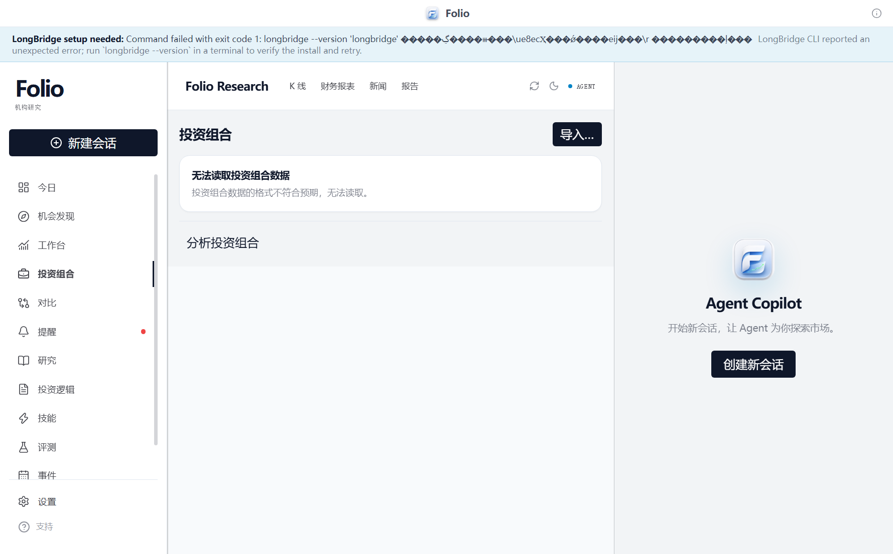
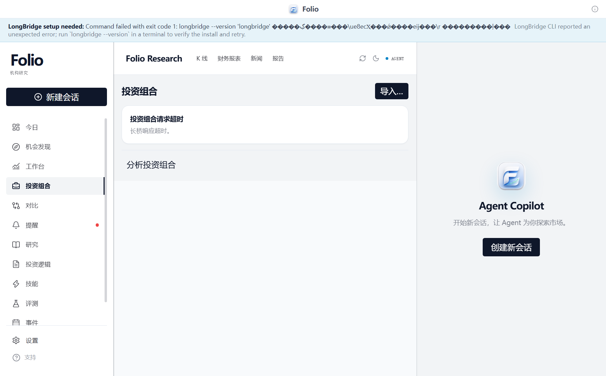
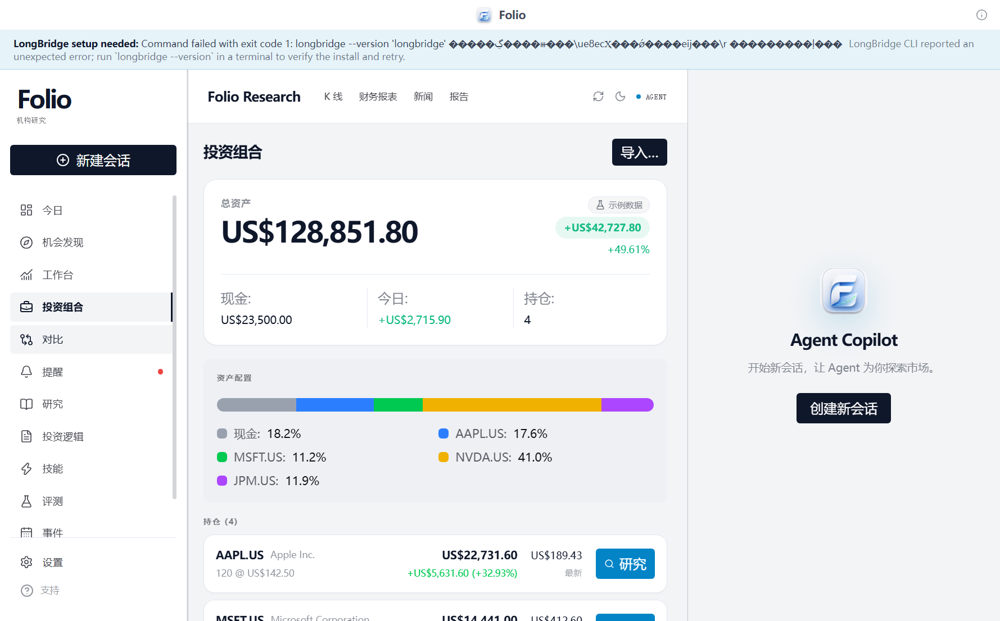
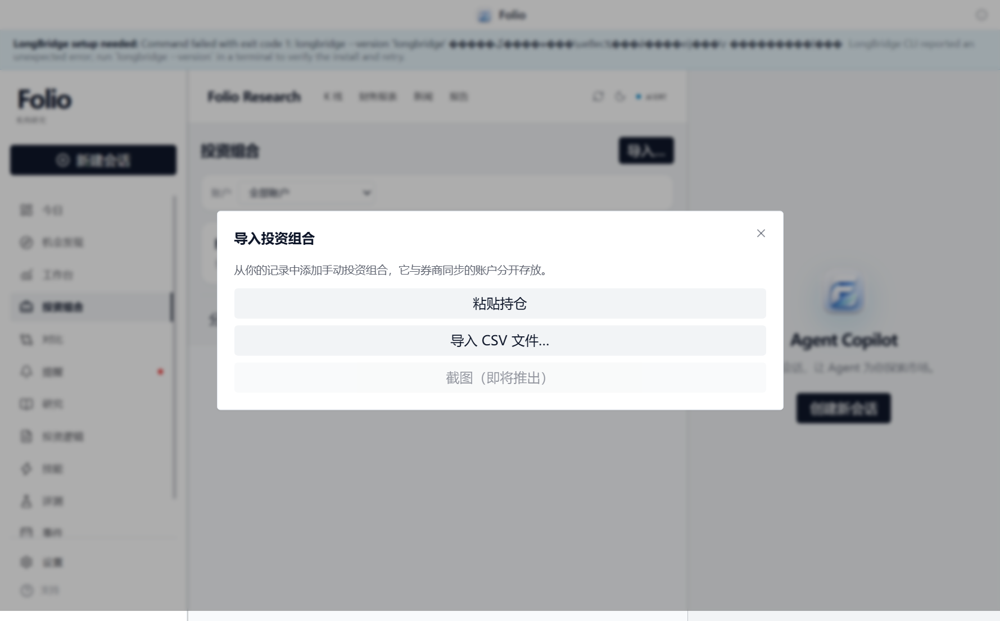

# Issue #298：保留组合失败分类

本次修复针对 #298 尚未解决的状态处理问题。已有失败文案本地化保持不变。
基线为 `9afa460`，生产代码通过统一错误出口保留 IPC 错误码，避免 catch 把所有失败都清空为示例数据。

## 回退策略

| 状态 | 数据与界面 | 缓存分类 |
| --- | --- | --- |
| `not-connected`、`no-account-permission` | 保持现有带徽标的示例组合 | 保留 `failure` 和安全错误信息 |
| `timeout`、`parse-error`、`provider-error` | 清空上次快照，显示已有分类失败卡片 | 保留 `failure`；不标记为已刷新 |
| IPC Promise 拒绝 | 按同一分类策略处理；普通异常归为 `provider-error` | 不向调用方产生未处理拒绝 |
| `empty` | 保持现有带徽标的示例组合 | 保持原有行为 |
| `partial` | 保留真实快照和本地化警告 | 保留 `partial` |
| 下一次成功 | 展示真实快照 | 清空旧错误与示例标记 |

导入按钮和手动账户选择器不再依赖券商快照存在。券商失败时仍能在手动组合与全部账户之间切换，并打开导入窗口；手动资产不与券商资产混合。

真实 Provider 路径使用 `AUTH_EXPIRED`、`TIMEOUT`、`PARSE_FAILURE`，UI 现在同时识别这些标准化代码及旧的 `LONGBRIDGE_*` 代码。CLI 未安装时在适配器中保留 `LONGBRIDGE_NOT_INSTALLED`，不再与普通 `PROVIDER_ERROR` 混淆，也不依赖英文错误文案判断。

## 自动化验证

环境：Windows x64、Bun 1.4.2。以下均为本地执行结果，不代表 GitHub CI 状态。

```text
bun test --isolate packages/ui/src/atoms/portfolioAtoms.test.ts packages/ui/src/components/workspace/PortfolioSection.test.tsx
修复前：4 pass / 10 fail

bun test --isolate packages/ui/src/atoms/portfolioAtoms.test.ts packages/ui/src/components/workspace/PortfolioSection.test.tsx packages/ui/src/components/today/TodayView.test.tsx packages/ui/src/lib/portfolioFailure.test.ts apps/electron/src/main/portfolioFailure.test.ts
修复后：41 pass / 0 fail

bun test packages/ui --isolate
425 pass / 0 fail，71 files

bun test --isolate
2081 pass / 10 skip / 0 fail，218 files

bun run typecheck
core/shared/ui/i18n/electron 全部 exit 0

bun run --cwd apps/electron build
renderer/preload/main 全部构建成功

node apps/electron/e2e/portfolio-failure.mjs
6 个实际应用场景通过
```

全量测试首次在文件沙箱内运行时，未改动的 Pi 会话清理测试因无法创建 `C:\tmp\pi` 失败；允许该测试临时目录后重跑全量通过。构建在沙箱内也曾因 esbuild 无法读取上级目录失败，授权访问后重跑成功。10 项跳过来自 Bash/Windows 平台差异、缺少真实账户 fixture 和符号链接能力。

独立审阅指出的标准化错误码丢失、手动入口被隐藏两个问题均新增回归测试并验证先失败后通过。主进程集成测试使用真实 `runProviderCall → ProviderFetchError → MarketDataService → toIpcResult → portfolioFailureFromError`，仅 stub Electron 原生宿主，避免只验证标准化之前的模拟错误码。

若 Electron 下载受限，可在安装时设置 `ELECTRON_SKIP_BINARY_DOWNLOAD=1`，然后为 E2E 设置 `ELECTRON_BINARY` 指向本机已有 Electron。正常安装不需要这两个设置。

## UI 验收

`apps/electron/e2e/portfolio-failure.mjs` 启动构建后的真实 Electron 应用，使用独立用户目录和中文语言设置。脚本在主进程替换 `market:getPortfolio` 的响应，采用标准化之后的 IPC 错误码，经真实 preload/IPC、atom 和页面验证结果；手动场景另替换 `portfolio:listManual`。它不调用真实金融账户，也不证明外部 Provider 在线可用。截图内示例资产仅来自仓库 fixture。

窗口保持隐藏，通过关闭后台节流、等待渲染帧，再原生截图，避免捕获导航前的旧画面。顶部 LongBridge 安装提示来自验收机未安装 CLI，与本次组合错误分类无关。

### 解析失败



### 超时



### 服务异常


### 未连接时的兼容行为



### 未授权时的兼容行为


### 券商失败时仍可导入


