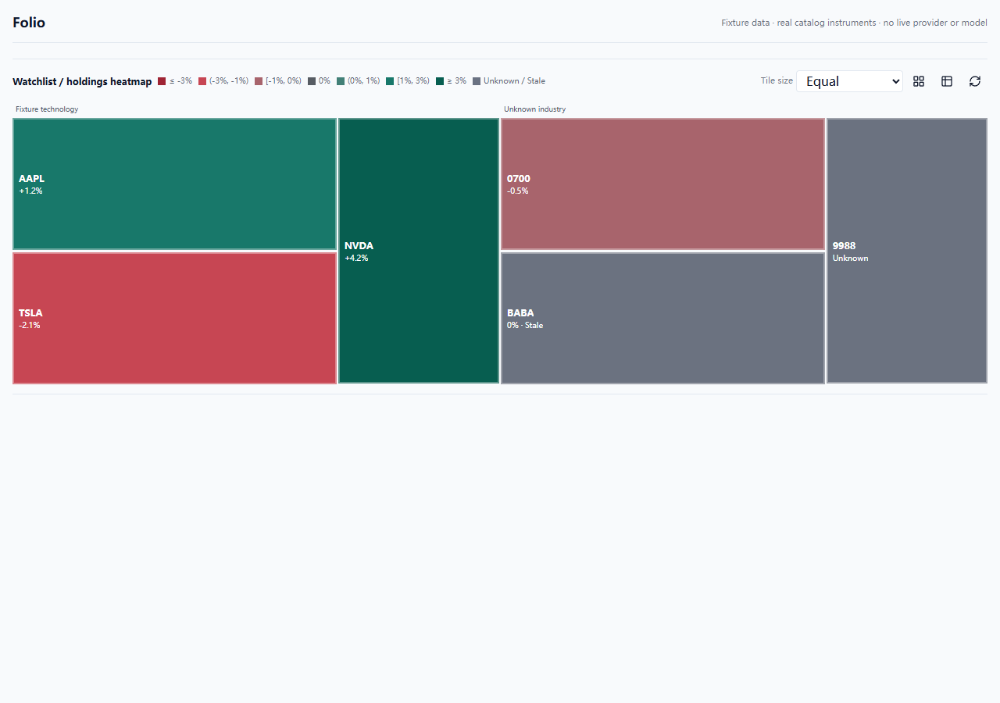
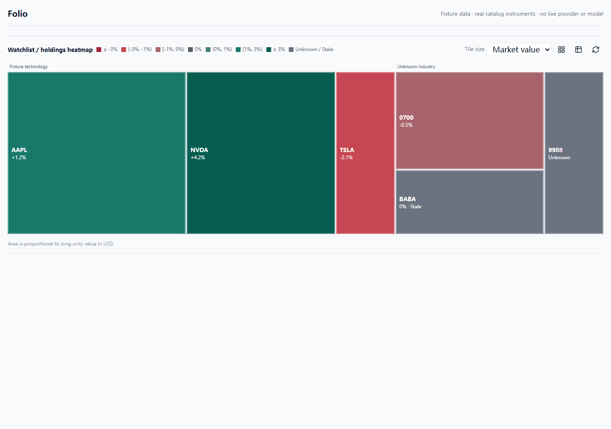
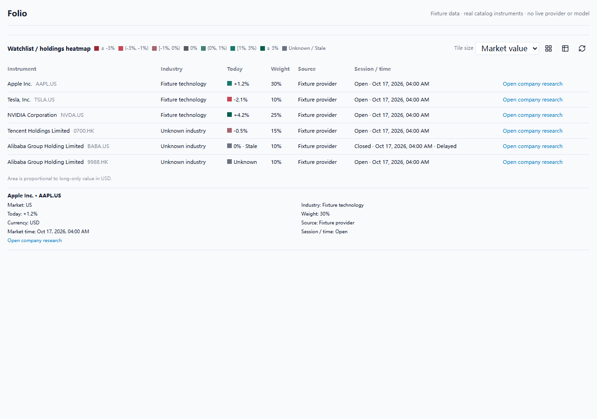
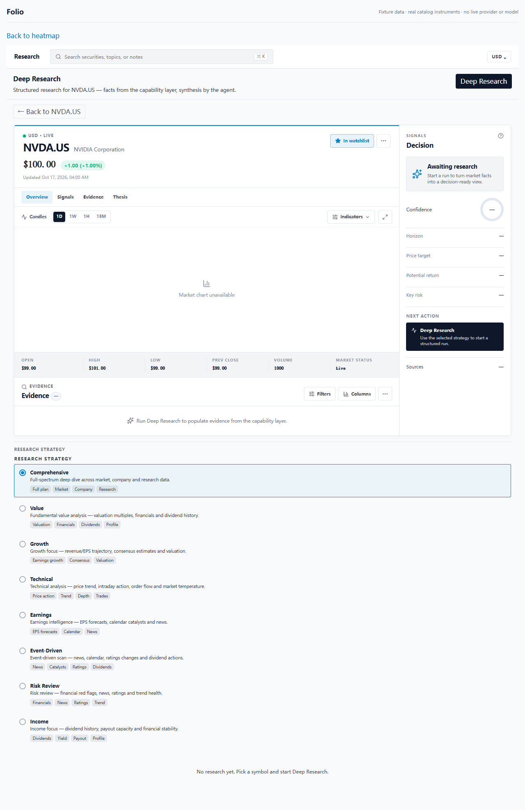
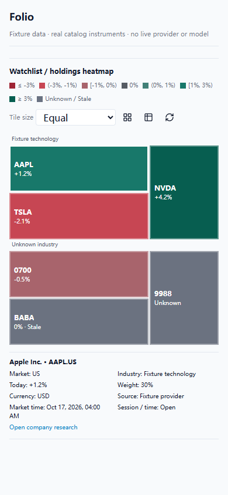

# Native watchlist and portfolio heatmap

Implements #333 in Today (the active watchlist) and Portfolio (the selected
account or manual portfolio). The map and its table consume one versioned
snapshot and share the workspace selection. Clicking a tile or pressing Enter
or Space opens company research for that canonical listing.

## Data and valuation

`HeatmapSourceSnapshot` carries schema version 1, source identity, content
revision, capture time, membership, and portfolio valuation currencies. The main
process validates the IPC payload, resolves canonical instruments with the
existing catalog, and aggregates aliases by `instrumentId`. Unresolved entries
remain visible as unresolved; the map never substitutes another listing.

`HeatmapService` uses the existing `MarketDataService`, router fetchers and
`CapabilityExecutor.runAll` scheduler: four concurrent instrument jobs, a
20-second timeout per job, and propagated cancellation. Ordinary quotes and
provenance-aware reads share the same in-flight request/cache. A cancelled
subscriber cannot abort a provider request another consumer still needs.
Renderer request ownership prevents one window cancelling another's request.

Only instrument lookups reach the existing provider gateway. Quantities and
market values stay in the local valuation path; they are not forwarded to a
new provider or included in the returned source metadata. There is no trading
action or third-party widget.

Industry groups use the profile's `(classification, code)` or, without a code,
`(classification, name)`. Missing classifications form an unknown group.
Massive's existing ticker-overview response provides `sic_description` and
`sic_code` ([official endpoint documentation](https://massive.com/docs/rest/stocks/tickers/ticker-overview)).
The adapter preserves four-digit string codes, including leading zeros. SIC is
an industry classification; no GICS sector is inferred from names or symbols.
Other providers can leave the optional industry metadata absent.

Watchlists use equal areas. Portfolios can select equal areas or long-only
market-value areas. Converted `marketValueBase` is usable only if the original
snapshot's valuation currency equals the selected base currency; otherwise an
amount already denominated in the selected currency is required. All long
positions must have comparable positive values and canonical identities before
weighted mode is enabled. No FX rate is guessed or fetched for drawing.
Short and zero exposures remain in the table with explanations and are excluded
from map areas and the weight denominator. A listing containing both long and
short entries is excluded rather than representing a gross absolute exposure.

## Display and selection

D3's treemap groups canonical listings by industry. A fixed visible legend
shows daily percentage-change bucket boundaries. Positive/negative numbers and
unknown/stale labels supplement color. Stale and missing quotes are gray;
unknown returns remain null. Delayed quotes, closed sessions, provider-stale
quotes and quotes older than 15 minutes are marked stale. Demo quotes and
quotes with missing time or mismatched identity never become current data.

Tooltips and selection details show identity, market, daily move, weight,
currency, source, market time and delay/session state. Table and map use the
same selected canonical listing; workspace selection updates also reach the
heatmap. Refresh retains selection. Old responses are cancelled/ignored and
membership from a previous source revision is hidden while the new source loads.
Demo portfolio cache data is shown as unavailable for this feature.

## Reproducible verification

Environment: Windows 11 Pro 10.0.26300, Intel i5-12600KF, Bun 1.4.2
(`744846f84`), Node 24.13.0, Edge 156.0.4314.42. Run from the repository root
unless a directory change is shown.

```sh
bun install --frozen-lockfile --ignore-scripts
# exit 0; lockfile accepted

bun test --isolate packages/core/src/heatmap.test.ts packages/shared/src/heatmap/service.test.ts packages/shared/src/agent/market-data-service.test.ts packages/shared/src/agent/agent.test.ts packages/shared/src/providers/massive/massive.test.ts packages/shared/src/providers/yahoo/yahoo.test.ts packages/ui/src/components/heatmap/HeatmapPanel.test.tsx apps/electron/src/main/kernelHost.test.ts
# 146 pass / 0 fail, 494 assertions

bun run typecheck
# core / i18n / shared / ui / electron: exit 0

bun run i18n:check
# en-US and zh-CN: 1541 keys, 0 issues

cd apps/electron
bun x vite build
# 2471 modules transformed; exit 0 (existing large-chunk advisory)
bun run build:main
# 703 modules bundled; exit 0
cd ../..
bun build apps/electron/src/preload/index.ts --outfile apps/electron/src/preload/index.cjs --target node --format cjs --external electron
# exit 0
```

The focused suite covers empty input, alias deduplication, missing quotes and
industry, closed/delayed/stale data, failed/demo/mismatched sources, USD/HKD
valuation, shorts and zero exposure, IPC validation/cancellation ownership,
cache sharing, selection preservation and outdated responses. An integration
test runs the actual Massive adapter, router, reference/quote caches and heatmap
service against fixture HTTP; it verifies no extra HTTP after cache warming and
that outbound URLs/bodies contain no portfolio quantities, values or account ID.

Expanded workspace regression:

```sh
bun test --isolate packages/core packages/i18n packages/shared packages/ui apps/electron
# 1959 pass / 1 fail across 203 files
# The one failure is pi-rpc-restart.test.ts: real child-process JSONL pipes
# times out at 5000ms on this Windows host.
```

The failing test was separately run on both this branch and the clean upstream
baseline `ec0b8d2791f343495533a7425e6d3ecab97977b2`:
`bun test --isolate packages/shared/src/agent/pi-rpc-restart.test.ts`
produced 9 pass / 1 fail on both. That test file is unchanged between this
baseline and current main `9afa4604e71a008391622b13a5415c87a9721e90`.
Live provider credentials and live model calls were not exercised.

### Browser interaction and screenshots

Start the existing Electron renderer Vite configuration, then run the harness:

```sh
cd apps/electron
bun x vite --host 127.0.0.1 --port 5174
```

In another terminal, from the repository root:

```sh
node apps/electron/e2e/heatmap-smoke.mjs
# 10 pass / 0 fail; no browser runtime errors
```

The harness renders the actual `HeatmapPanel` and `ResearchPanel` with six real
catalog identities: AAPL, TSLA, NVDA, 0700.HK, BABA and 9988.HK. Prices,
positions and industry examples are fixtures, explicitly labeled in the page.
It checks equal and value-proportional areas, ratio percentages, table/refresh
selection, Enter and mouse navigation to research, 390px layout, and 100 DOM
tiles with positive dimensions contained within the map. `HEATMAP_URL` overrides
the Vite harness URL; `HEATMAP_BROWSER` overrides the default `msedge` channel.
Generated screenshots and JSON reports go to `apps/electron/e2e/artifacts/heatmap`.

| Equal area | Portfolio market value |
| --- | --- |
|  |  |





### 100-instrument fixture measurements

The focused tests generate 100 fixture instruments and use the production
service/cache/scheduler plus the renderer's actual D3 layout function. One
recorded run loaded the cold fixture in 41.6ms and the warm fixture in 4.4ms:
100 quote fetches, 100 profile fetches and one status fetch in total, with four
concurrent quote operations maximum and no additional warm-cache calls. Each
fake quote intentionally waits 1ms. The 100-rectangle D3 layout took 0.9ms.

The browser harness's `?count=100` mode renders 100 synthetic identities through
the real React component; one warm Vite navigation-to-100-tiles measurement was
221ms. These are reproducible fixture measurements, not live-provider latency
or a production performance guarantee. The harness writes measured durations
to `report.json` on every run.
