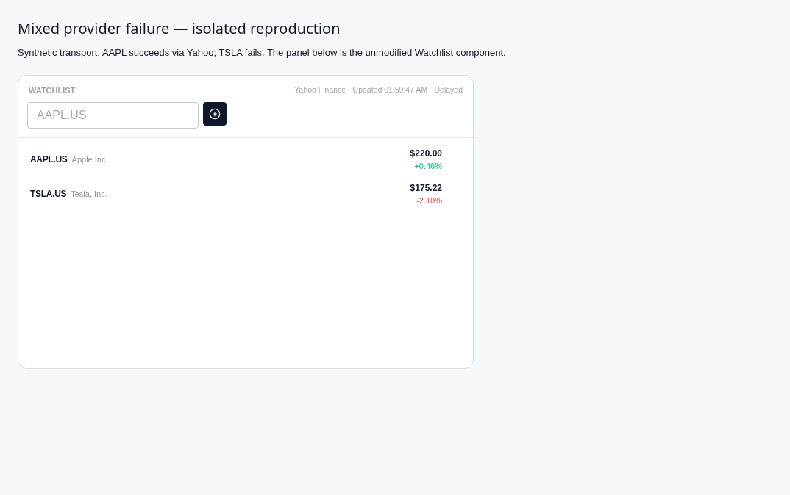
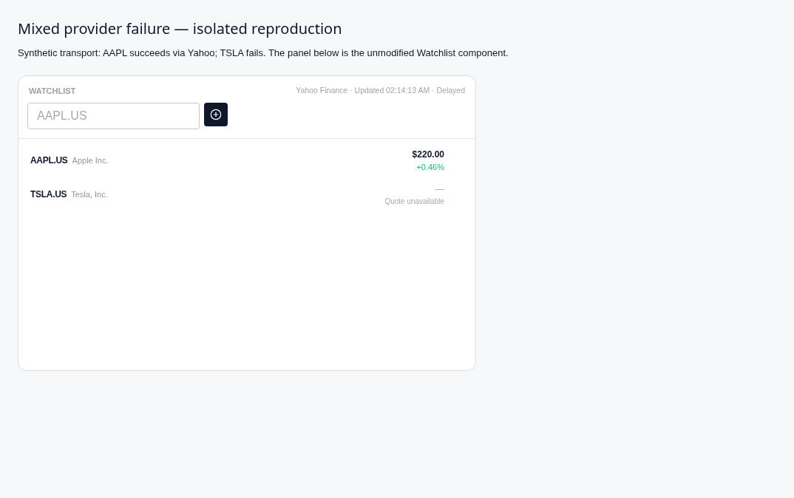
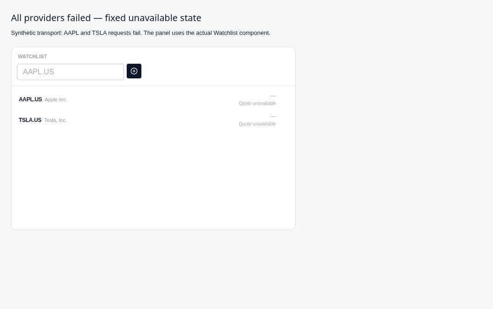

# Yahoo 数据完整性修复与验证（2026-10-19）

基线：main `038f20cf2d87e3575ffbe5469967bdf6ef960dc8`（#353）。独立分支 `fix/yahoo-data-integrity-20261019`；未改发布分支、未合并或发版。

## 复现 → 修复

1. **来源链错误**：真实 Yahoo adapter + router 在合成 HTTP 响应下返回 `yahoo / delayed=true / fallbackUsed=true`，但 kline/profile capability 与金融证据 envelope 写成 Longbridge、缺少 delayed/fallback。新增可选的 `getKlineResult` / `getStaticInfoResult`，沿用 quote 的 reportProvider 接口贯通 provenance；原有 payload-only fetchers 兼容保留。quote、kline、profile 三者现在均保留 Yahoo、延迟与 fallback lineage。显式离线 demo 的 kline companion 同时保留 demo provenance，不会因新接口绕过既有 opt-in。
2. **失败示例价格混入**：AAPL 成功、TSLA 失败时，原 Watchlist 静默显示 TSLA 示例 `$175.22 / -2.10%`，顶部却标 Yahoo 与刚生成的示例时间。现在失败清除该行数据与时间，显示“行情暂不可用”，详情保留 provider 错误；来源/新鲜度只汇总成功的非 demo 行。覆盖部分失败、全部失败与已有价格刷新失败。
3. **集成测试加载失败**：`apps/electron/src/main/kernelHost.test.ts` 的 `@finagent/shared` mock 缺少新增 Yahoo class。已补齐。基线单文件为 0 pass / 1 fail / 1 error；更旧 main ec0b8d27 同文件17 pass。原错误：`SyntaxError: Export named 'YahooChartFinancialDataProvider' not found in module '.../packages/shared/src/index.ts'.`
4. **昨收基准错误风险**：移除多日范围 `previousClose/chartPreviousClose` 兜底，不以价格相等判断日线身份，也不使用本机今天。quote 请求1个月日线，以 `regularMarketTime` 在 `exchangeTimezoneName` 的日期为报价会话，严格使用之前会话的 Close。按交易所日期归并重复行并保留 null 槽位；盘中 `[100,105,null]` + regularMarketPrice108 得到昨收105、涨跌3。周末/周一盘前若报价仍属周五，则昨收是周四；周一盘中报价则取周五。

实现位置：[router companions](../../packages/shared/src/providers/router-fetchers.ts)、[K线 capability](../../packages/shared/src/capabilities/manifests/market-kline.ts)、[profile capability](../../packages/shared/src/capabilities/manifests/company-profile.ts)、[Yahoo adapter](../../packages/shared/src/providers/yahoo/adapter.ts)、[quote atoms](../../packages/ui/src/atoms/quoteAtoms.ts)、[Watchlist](../../packages/ui/src/components/stock/Watchlist.tsx)。

## 昨收验证边界

- 使用普通 Close，不用含分红调整的 Adj Close；不会把历史 Close 再按拆股比例除一次，也不根据价格跳变猜测拆股。
- 缺少报价时间、价格、有效时区、报价会话日线或前一工作日 Close 时，返回明确 NOT_FOUND / quote unavailable，不编造零涨跌，不向更早非空值扫描。
- 当前没有权威美国休市日历：无法区分整日休市和缺数时，只接受前一工作日（跳过周六/周日）的会话。因此节假日缺口保守不可用。这是明确的覆盖限制，不能宣称全场景可靠。
- 报价/前一会话附近的拆股事件若不能认证两者价格口径，保守不可用；早于两者的历史拆股不再次调整。
- 查阅了 yfinance 项目本身的 [regular_market_previous_close](https://github.com/ranaroussi/yfinance/blob/2081dca0b224512ff768f9c5e6bd9c658a3b8339/yfinance/scrapers/quote.py#L308-L326) 和 [日线重复行处理](https://github.com/ranaroussi/yfinance/blob/2081dca0b224512ff768f9c5e6bd9c658a3b8339/yfinance/utils.py#L687-L711)，作为独立实现参考；这不是 Yahoo 官方 API 合约或本环境 live 成功证明。

## 首版 `6111a7e` 实际验证

以下保留首版实测记录；独立审查后的异步拆股修补与新验证见文末。

环境：Linux x64，Bun **1.4.2 (744846f84)**；本轮审查已用 frozen lock 安装依赖，修复无依赖变更。Electron **39.8.9** 官方二进制已校验 SHA256；Xvfb + 构建后 renderer/main + 隔离新 userData。容器测试需使用 `--no-sandbox` 启动参数，未修改应用 webPreferences、凭据或网络安全配置。

```text
bun test --isolate packages/shared/src/providers/yahoo/yahoo.test.ts packages/shared/src/kernel/quote-provenance-acceptance.test.ts packages/shared/src/agent/demo-market-data.test.ts packages/ui/src/atoms/quoteAtoms.test.ts packages/ui/src/components/stock/Watchlist.test.tsx apps/electron/src/main/kernelHost.test.ts
→ 78 pass / 0 fail，487 expectations，6 files

bun run test:integration
→ 2009 pass / 7 skip / 0 fail，8679 expectations，2016 tests / 215 files
→ 随后的 core/i18n/shared/ui/electron typecheck 全部 exit 0

bun run i18n:check
→ en-US / zh-CN 各1507 keys，0 issues，exit 0

bun run build
→ renderer / preload / main 全部成功，exit 0；保留既有大 chunk warning

FINAGENT_AGENT_PROVIDER=local bun scripts/eval/run.ts --smoke --mode fixture --store <isolated-store> --out <artifact.json>
→ 15 requested / started / evaluated，0 infraFailed / skipped，valid，exit 0

独立 node / Playwright CDP 脚本，真实 Electron + Xvfb
→ 5/5 pass，0 pageerror：renderer/IPC、新本地确定性会话、AAPL workspace、Yahoo connection IPC、Connections UI

独立真实 Watchlist renderer + 合成 transport
→ mixed / all-failed 两种状态通过；无示例价格，无 demo badge；成功行提供来源和市场时间

git diff --check + PR 工作流相同 high-signal secret patterns（仅变更 production 文件）
→ pass
```

新增回归覆盖：盘中、盘后、周末、周一盘前/盘中、UTC/交易所日期不同、当前 close=null、连续同价、重复会话、前一 close=null、前一整日缺失、空 bars、无当前日 bar、无效 timestamp/timezone、缺报价时间/价格、拆股边界与历史拆股、Close/Adj Close 分离；quote/kline/profile 的真实 adapter/router/capability/evidence 路径；Watchlist 部分/全部失败及失败刷新；内核加载和明确 opt-in demo 兼容。

首轮新增测试发现一个错误的 i18n namespace，已修正；首轮 typecheck 发现新增 demo 测试的泛型推导为 never，已补准确接口类型。最终上述验证均已重跑通过，不作为基线忽略。

## Live、平台与授权限制

- 本轮真实 AAPL quote / daily kline 请求均未成功：Bun fetch 返回 `getaddrinfo ETIMEOUT query1.finance.yahoo.com`。前次 main 审查观察到 HTTP403 `Domain forbidden`。均为真实取数阻断，未改代理、未尝试绕过，不把 fixture 当 live。
- 真实 Electron 页面也显示 Yahoo 不可用；本地确定性会话通过不等于 real-model 验收。未调用真实付费模型或 judge。
- 项目原 `bun run test:e2e` runner 仍硬编码 macOS Electron.app 路径；Linux 不能运行原套件。独立 Linux Electron smoke 是补充验证，不宣称原 E2E/macOS 发布包通过。
- standalone live eval 仍依赖 Longbridge preflight；本 PR 未扩展该范围，也未修改 #350、发布流程或其他贡献者 PR。

## UI 对比（合成传输，实际组件）

修复前，TSLA 失败仍显示示例价格，无逐行标记，时间来自示例数据：



修复后，成功 AAPL 保持 Yahoo 与真实 payload 时间，TSLA 明确不可用：



全部失败时不显示来源/更新时间或样例价格：



原始审查日志、完整 provenance envelopes、截图和本轮独立脚本均保存在隔离证据目录，未覆盖旧报告。Library 上传此前因网络失败，未获得 library_file_id；本报告与图片随 PR 提供可审查版本。

## 独立审查追补：晚于报价的拆股也可能造成异步口径

审查确认首版 guard 只拒绝 `previousTime <= splitTime <= quoteTime`，漏掉晚于报价时间的同响应拆股。这是**合成反例**，不声称 live Yahoo 已观察到：周五 `regularMarketPrice=400`，周四/周五 Close 已调整为99/100，同响应拆股日期是下周一、比例4:1。旧代码返回成功，产生约 +304.04% 的错误日涨幅。

现在只要同响应拆股时间在前一会话起或更晚，即无法认证报价与历史口径，明确返回 `NOT_FOUND` / quote unavailable；不再用 quoteTime 作为检查上限，不自动乘除拆股比例。早于两者的历史拆股行为保持不变；不新增交易日历或扩大到其他 PR。

新增两个回归：报价后的同日拆股、下周一拆股。两者都使用报价400与历史99/100的异步口径，断言失败及明确的“前收无法验证”错误。

```text
旧 guard + 新回归：
bun test packages/shared/src/providers/yahoo/yahoo.test.ts --test-name-pattern 'unavailable when a later split'
→ 0 pass / 2 fail / 43 filtered out（两个响应原先都错误返回 ok=true）

修补后，重跑上文相同六文件 focused 命令：
→ 80 pass / 0 fail，493 expectations

bun run test:integration
→ 2011 pass / 7 skip / 0 fail，8685 expectations，2018 tests / 215 files
→ 随后 core/i18n/shared/ui/electron typecheck 全部 exit 0

bun run build
→ renderer / preload / main 全部成功，exit 0；既有 large-chunk warning

git diff --check + changed-production high-signal secret scan
→ pass
```

本次没有重跑 UI 截图、本地 agent eval 或真实网络请求：可见状态和传输代码未变；上文截图和 Electron smoke 保留为首版证据。真实行情成功验收仍未完成，先前 DNS/403 限制不因这次合成回归通过而消失。PR 创建继续暂停，等待用户对该外部写操作明确确认。
